# 8-Bit SAP-1 Microprocessor with Python Assembler & Auto-Loader

A fully operational, custom **8-bit SAP-1 (Simple-As-Possible) Microprocessor** designed and simulated in **Logisim-evolution**, complete with a custom software toolchain (Python Assembler) and automated hardware memory loading.

Developed as part of the **ETE 404: VLSI Technology Sessional** project at the Chittagong University of Engineering & Technology (CUET).

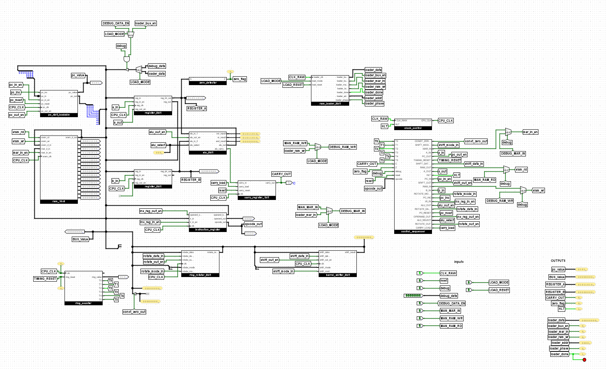

---

## Key Features & Architecture

* **Data & Address Bus:** 8-bit main data bus and 4-bit memory address bus (supporting 16 unique RAM locations).
* **Registers:** 8-bit Accumulator ($A$), 8-bit $B$ Register, 8-bit Instruction Register ($IR$), 4-bit Program Counter ($PC$), and 4-bit Memory Address Register ($MAR$).
* **Instruction Set Architecture (ISA):** 16 custom instructions including Arithmetic (`ADD`, `SUB`), Logical (`AND`, `OR`, `XOR`, `CLR`), Data Movement (`LDA`, `LDB`, `STA`), Branching (`JMP`, `JC`, `JNZ`), and Advanced Bit Manipulation (`SHIFT`, `ROTATE`).
* **Advanced Bit Manipulation Units:** Dedicated 8-bit **Barrel Shifter** and **Ring Rotator** supporting variable-distance logical shifts and cyclic rotations ranging from 0 to 7 bit positions.
* **Flag System:** Synchronous 1-bit Carry Register and combinational Zero Detector (8-input NOR) for conditional branching.
* **Python Assembler (`assembler_8bit.py`):** Translates human-readable assembly code with labels, `.ORG` offsets, and `DB` data directives into Logisim-compatible `v3.0 hex words`.
* **RAM Auto-Loader:** Debug-protocol based hardware auto-loader that copies machine code from template ROM into the active SRAM seamlessly.

---

## Core Components

### Top-Level Architecture


### ALU (8-bit)
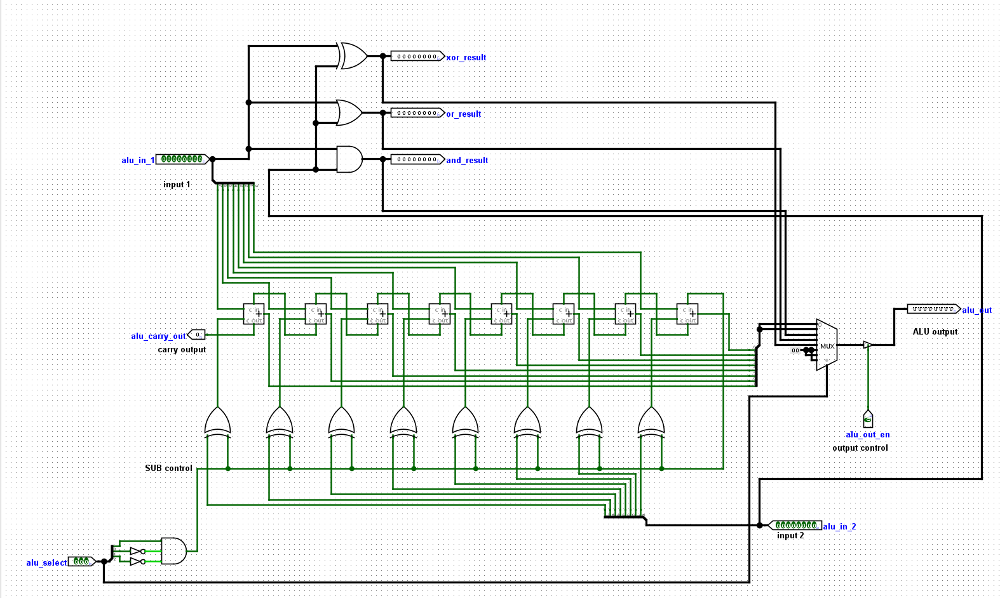

### Barrel Shifter
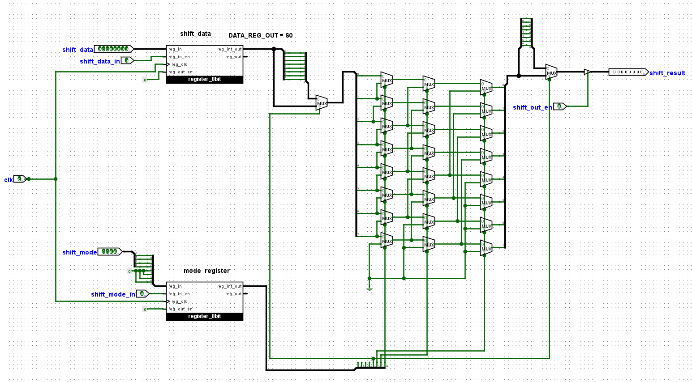

### Ring Rotator
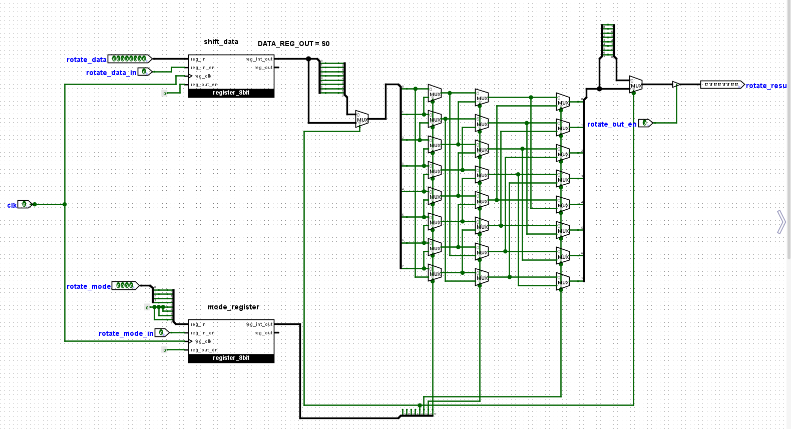

### Control Sequencer
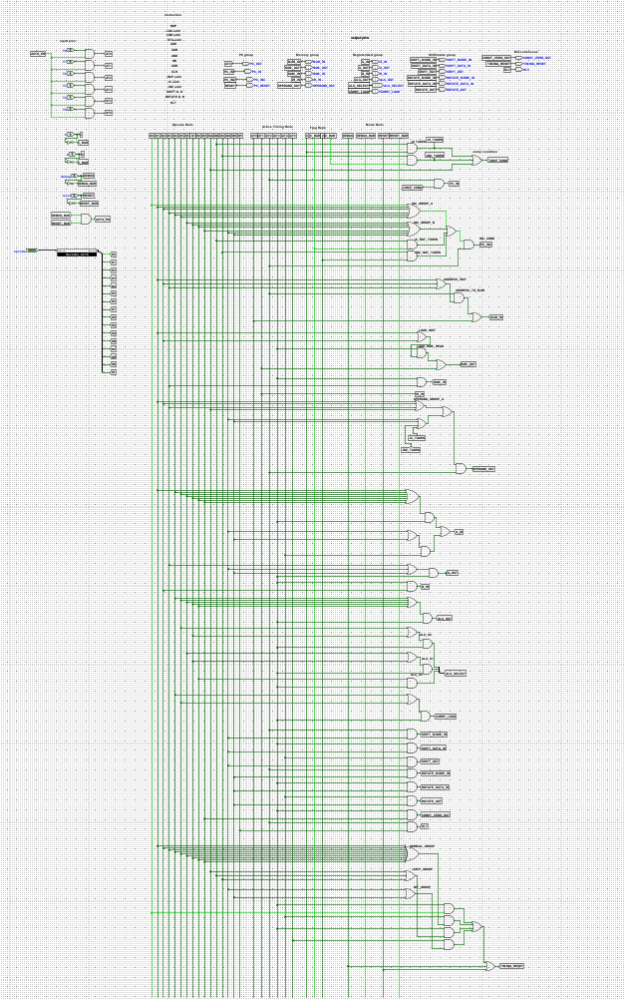

### Decoder
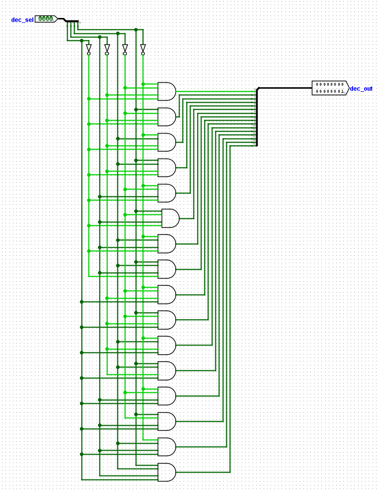

### Instruction Register
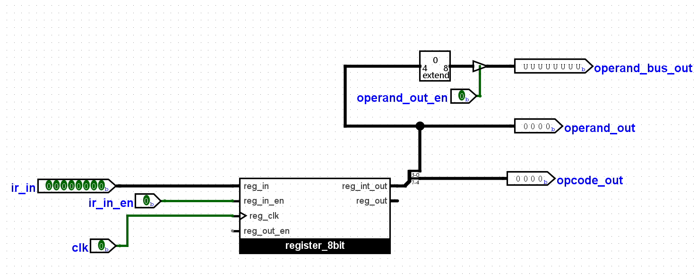

### Program Counter (4-bit)
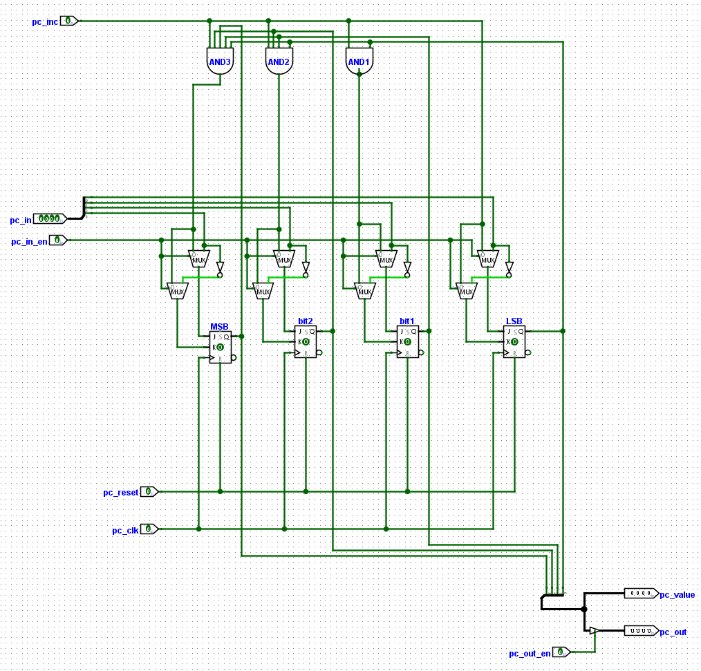

### RAM (16×8)
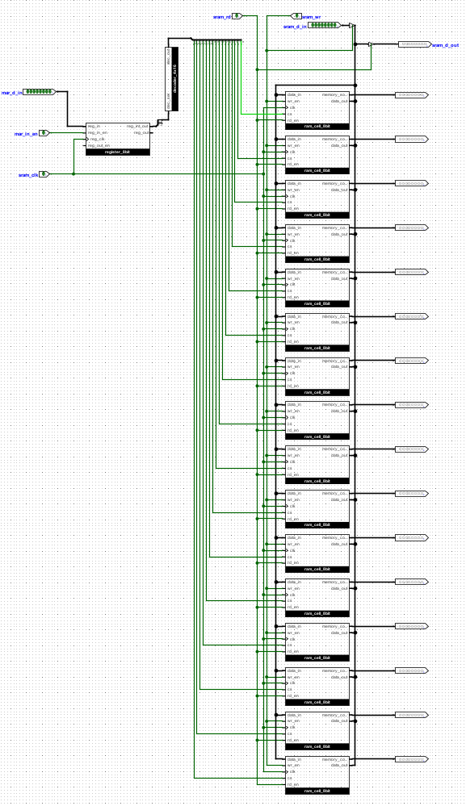

### 8-bit Register
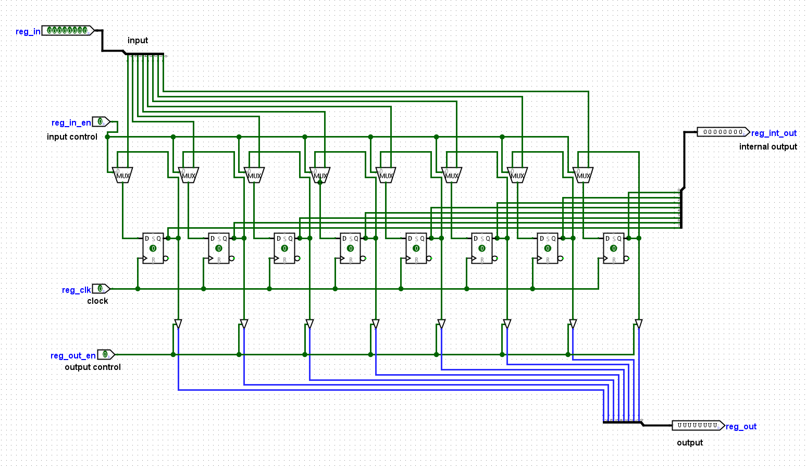

### Ring Counter
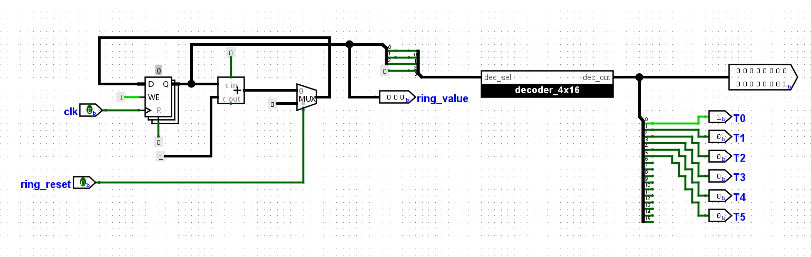

### RAM Auto-Loader
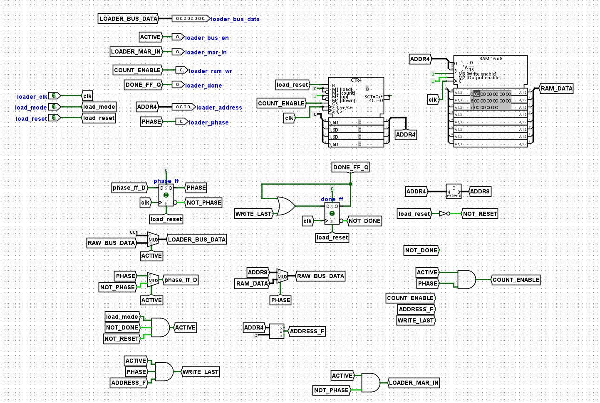

---

## Repository Structure

```text
SAP1_8bit_Project/
│
├── SAP1_8bit_Final.circ          # Main Logisim Project file
├── README.md                     # Project Documentation
├── Project_Report.pdf            # Complete LaTeX Project Report
│
├── Assembler/                    # Assembler Toolchain & Source Files
│   ├── assembler_8bit.py         # Python Assembler Source Script
│   ├── program.asm               # Assembly Source Code
│   ├── ram_image.hex             # Generated Logisim v3.0 Hex Image
│   └── listing.txt               # Address-by-Address Assembly Listing
│
└── screenshots/                  # Circuit and Simulation Snapshots
    ├── alu_8bit.png
    ├── barrel_shifter.png
    ├── control_sequencer.png
    ├── decoder.png
    ├── instruction_register.png
    ├── loader.png
    ├── pc_4bit.png
    ├── ram_16x8.png
    ├── register_8bit.png
    ├── ring_counter.png
    ├── ring_rotator.png
    └── sap1_final_top.png
